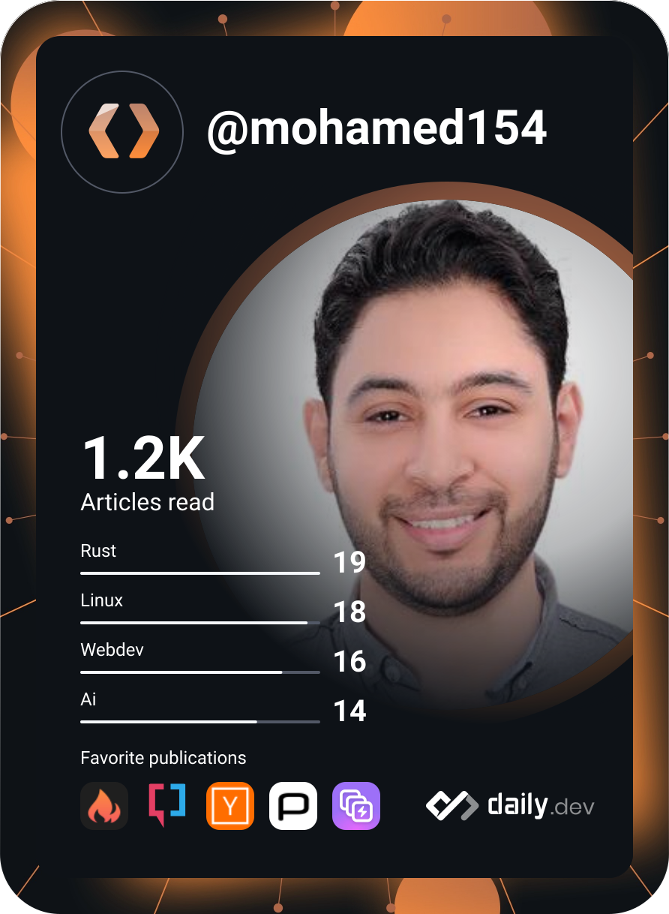

<!-- Header -->
<p align="center">
  
</p>

<p align="center">
  <a href="https://git.io/typing-svg">
    
  </a>
</p>

<p align="center">
  <a href="https://linkedin.com/in/mohamed-ahmed-ramadan"></a>
  <a href="mailto:mohamedahmedramadan154@gmail.com"></a>
  <a href="https://drive.google.com/file/d/1hdM3tPGg8ssIVQlHKDKYaQyaocxzkiM5/view?usp=sharing"></a>
  <a href="https://twitter.com/mohamed_aramdan"></a>
  <a href="https://dev.to/mohamed155"></a>
  <a href="https://medium.com/@mohamedahmedramadan154"></a>
</p>

<p align="center">
  
</p>

---

## 👋 About me

I'm a **Senior Frontend Engineer** with **7+ years** of experience turning complex product requirements into fast, accessible, and maintainable web applications. I care about clean architecture, strong typing, and the kind of developer experience that lets teams ship confidently.

Right now I'm building enterprise fintech products as a **Senior React Developer at [Crealogix](https://crealogix.com)** (via **eSpace**), and I've previously delivered work for **Optus (Australia, remote)**, **Intouch.com**, and **UrWave Solutions**.

```ts
const mohamed = {
  role: "Senior Frontend Engineer",
  location: "Alexandria, Egypt 🇪🇬",
  education: "B.Sc. Computer Science — Alexandria University",
  focus: ["React", "Angular", "TypeScript", "Next.js", "Frontend Architecture"],
  alsoWorksWith: ["Node.js", "NestJS", "Express", "Flutter", "React Native", "Flask"],
  currentlyLearning: "LLM Engineering & AI-powered products",
  askMeAbout: "Anything in the JavaScript ecosystem",
  funFact: "Can talk about games, code, and tech trends for hours 🎮",
};
```

## 🚀 What I do

- **Frontend architecture** — design systems, micro-frontends, state management, and scalable folder/module structures for large codebases.
- **Performance & quality** — Core Web Vitals, SSR/SSG with Next.js, bundle optimization, testing strategy, and code review culture.
- **Full-stack delivery** — REST/GraphQL APIs with Node.js & NestJS, plus cross-platform mobile apps with Flutter and React Native.
- **Engineering standards** — writing frontend blueprints and policy baselines that help whole teams build consistently.
- **AI engineering** — integrating LLMs into real products: prompting, RAG, and agent-style workflows.

## 🛠️ Tech stack

<p align="center"><b>Core</b></p>
<p align="center">
  
</p>

<p align="center"><b>Backend & mobile</b></p>
<p align="center">
  
</p>

<p align="center"><b>Data, cloud & tooling</b></p>
<p align="center">
  
</p>

## 📊 GitHub stats

<p align="center">
  
  
</p>

<p align="center">
  
</p>

<p align="center">
  
</p>

<p align="center">
  
</p>

## 🧩 Around the web

<p align="center">
  <a href="https://stackoverflow.com/users/5674305"></a>
  <a href="https://www.leetcode.com/mohamed155"></a>
  <a href="https://codeforces.com/profile/mohamedramadan154"></a>
  <a href="https://www.hackerrank.com/mohamed_ramadan2"></a>
  <a href="https://kaggle.com/mohamedramadan154"></a>
  <a href="https://codepen.io/mohamed155"></a>
  <a href="https://codesandbox.com/mohamed155"></a>
</p>

<details>
<summary align="center"><b>📇 daily.dev card</b></summary>
<br />
<p align="center"></p>
</details>

---

<p align="center">
  <i>Always open to interesting problems, collaborations, and good conversations about code (or games).</i><br/>
  <b>Let's build something great together.</b>
</p>

<p align="center">
  
</p>
